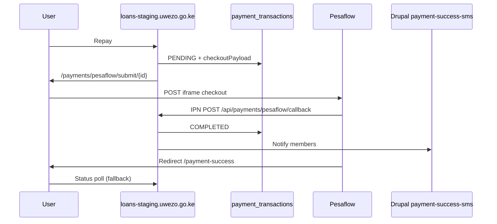

# Pesaflow Payment Integration — May 2026

Full integration guide for Uwezo loan repayments via Pesaflow iframe checkout, IPN webhooks, status polling, and post-payment member SMS.

---

## Overview

| Step | What happens |
|------|----------------|
| 1 | User clicks **Repay loan** on an approved/disbursed loan (dashboard) |
| 2 | User enters repayment amount in modal; portal creates `payment_transactions` row + Pesaflow invoice (`format=json`) |
| 3 | Modal embeds Pesaflow checkout iframe via `invoice_link` (no new tab) |
| 4 | User pays (M-Pesa STK, card, etc.) on Pesaflow |
| 5 | Pesaflow POSTs IPN to `/api/payments/pesaflow/callback` |
| 6 | Portal marks payment **COMPLETED**, sends SMS to all group members |
| 7 | User lands on `/payment-success` (status poll if IPN is delayed) |

---

## Architecture



---

## Environment variables

Add to `Loan_Application/.env` and ensure they are passed through `docker-compose.yml`:

| Variable | Required | Example | Purpose |
|----------|----------|---------|---------|
| `PESAFLOW_CHECKOUT_URL` | Yes | `https://test.pesaflow.com/PaymentAPI/iframev2.1.php` | Iframe checkout POST target |
| `PESAFLOW_STATUS_URL` | No | `https://test.pesaflow.com/api/invoice/payment/status` | Payment status fallback query |
| `PESAFLOW_API_CLIENT_ID` | Yes | `366` | Pesaflow client ID |
| `PESAFLOW_SERVICE_ID` | Yes | `229030` | Pesaflow service/account ID |
| `PESAFLOW_HMAC_KEY` | Yes | *(from Pesaflow)* | Consumer key for HMAC |
| `PESAFLOW_HMAC_SECRET` | Yes | *(from Pesaflow)* | Secret appended to hash data string |
| `PESAFLOW_BILL_DESC` | No | `Uwezo Fund Repayment` | Bill description |
| `PESAFLOW_SEND_STK` | No | `false` | Push M-Pesa STK on checkout (off by default) |
| `PESAFLOW_CALLBACK_SECRET` | No | random string | Optional IPN endpoint auth |
| `NEXT_PUBLIC_APP_URL` | Yes | `https://loans-staging.uwezo.go.ke` | Public portal base URL for callbacks |
| `EXTERNAL_API_KEY` | Yes | *(Drupal api_key)* | Server SMS after payment |

Legacy aliases `PESAFLOW_API_URL` → checkout URL and `PESAFLOW_API_KEY` → HMAC key are still read as fallbacks in config.

---

## Pesaflow payload (iframe checkout)

Built in `web/lib/payments/pesaflow-checkout.ts`:

```json
{
  "apiClientID": "366",
  "serviceID": "229030",
  "billDesc": "Uwezo Fund Repayment",
  "currency": "KES",
  "billRefNumber": "WF-1776080540619-3MLREI-ABC12XYZ",
  "clientMSISDN": "254720501239",
  "clientName": "Gideon Njoroge",
  "clientIDNumber": "26447696",
  "clientEmail": "user@example.com",
  "callBackURLOnSuccess": "https://loans-staging.uwezo.go.ke/payment-success?applicationId=APP-xxx&amount=20.00&billRefNumber=WF-...",
  "amountExpected": "20.00",
  "notificationURL": "https://loans-staging.uwezo.go.ke/api/payments/pesaflow/callback",
  "secureHash": "<computed>",
  "PictureURL": "",
  "format": "json",
  "sendSTK": "true"
}
```

### secureHash algorithm

Implemented in `web/lib/payments/pesaflow-hash.ts` (Appendix I):

```
data = apiClientID + amountExpected + serviceID + clientIDNumber + currency
     + billRefNumber + billDesc + clientName + secret

hex  = HMAC-SHA256(data, key) as lowercase hex
secureHash = Base64(hex string)
```

**Status query hash** (fallback):

```
data = apiClientID + billRefNumber
secure_hash = Base64(HMAC-SHA256 hex)
```

---

## Callback URLs (use your own domain)

| Pesaflow field | Staging URL |
|----------------|-------------|
| `callBackURLOnSuccess` | `https://loans-staging.uwezo.go.ke/payment-success?...` |
| `notificationURL` | `https://loans-staging.uwezo.go.ke/api/payments/pesaflow/callback` |

Production: replace host with `https://loans.uwezo.go.ke`.

Pesaflow must be able to reach `notificationURL` over HTTPS. Whitelist your domain with Pesaflow if required.

---

## Database

New table `payment_transactions` (Prisma migration `20260525160000_add_payment_transactions`):

| Column | Purpose |
|--------|---------|
| `billRefNumber` | Unique Pesaflow invoice ref |
| `applicationId` | Links to loan application |
| `amountExpected` / `amountPaid` | Payment amounts |
| `status` | `PENDING` \| `COMPLETED` \| `FAILED` \| `CANCELLED` |
| `checkoutPayload` | Exact POST fields sent to Pesaflow |
| `ipnPayload` | Raw IPN body for audit |
| `smsSentAt` | When member SMS was triggered |

---

## Files added / modified

### New files

| Path | Purpose |
|------|---------|
| `web/lib/payments/pesaflow.config.ts` | Env config reader |
| `web/lib/payments/pesaflow-hash.ts` | secureHash generation |
| `web/lib/payments/pesaflow-checkout.ts` | Payload builder |
| `web/lib/payments/pesaflow-status.ts` | Status API client |
| `web/lib/payments/pesaflow-ipn.ts` | IPN + confirmation logic |
| `web/lib/data/payment-transaction.ts` | DB helpers |
| `web/components/pesaflow-checkout-form.tsx` | Auto-submit POST form |
| `web/app/payments/pesaflow/submit/[paymentId]/page.tsx` | Checkout redirect page |
| `web/prisma/migrations/20260525160000_add_payment_transactions/` | DB migration |

### Modified files

| Path | Change |
|------|--------|
| `web/lib/payments/pesaflow.service.ts` | Full initiate + checkout session |
| `web/lib/payments/pesaflow.types.ts` | Expanded types |
| `web/components/loan-repay-modal.tsx` | Redirect to submit page |
| `web/app/api/payments/pesaflow/callback/route.ts` | Real IPN handler |
| `web/app/payment-success/page.tsx` | Status poll + confirmation UI |
| `web/prisma/schema.prisma` | `PaymentTransaction` model |
| `Loan_Application/docker-compose.yml` | Pesaflow env vars |

---

## Deployment steps

### 1. Set environment variables

Edit `Loan_Application/.env` with Pesaflow test credentials from your integration contact.

### 2. Run database migration

```bash
docker exec uwezo-web-1 npx prisma migrate deploy --schema=/app/web/prisma/schema.prisma
```

### 3. Rebuild and restart web container

```bash
cd Loan_Application
docker compose build web
docker compose up -d web
docker exec uwezo-nginx-1 nginx -s reload
```

### 4. Configure Pesaflow

- Use **test** URLs/credentials until UAT passes
- Confirm iframe checkout mode (not Create Invoice API unless Pesaflow specifies otherwise)
- Whitelist `loans-staging.uwezo.go.ke` for IPN if required

---

## Testing checklist

1. Set all required env vars → Repay button becomes active
2. Click Repay → lands on Pesaflow checkout
3. Complete test payment on Pesaflow sandbox
4. Verify IPN in web logs: `[Pesaflow IPN] Received notification`
5. Verify `payment_transactions.status = COMPLETED`
6. Verify member SMS in Drupal watchdog
7. Verify `/payment-success` shows confirmed state

---

## Known limitations / future work

- **Repayment amount** — modal uses full `loanAmount`; installment logic not yet implemented
- **LMS / Drupal sync** — payment does not yet update loan balance in LMS or Drupal
- **IPN `token_hash` verification** — add when Pesaflow confirms spec
- **Create Invoice API** — not implemented; iframe checkout only
